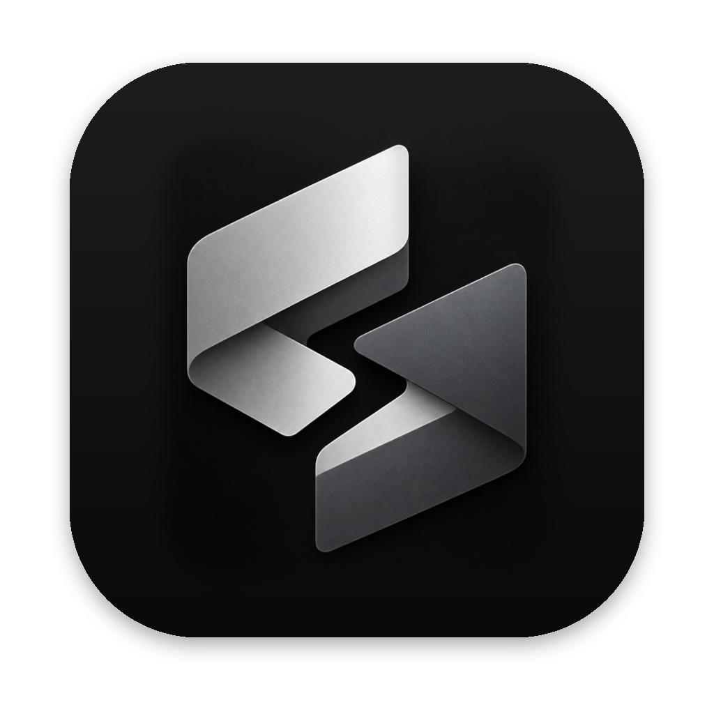
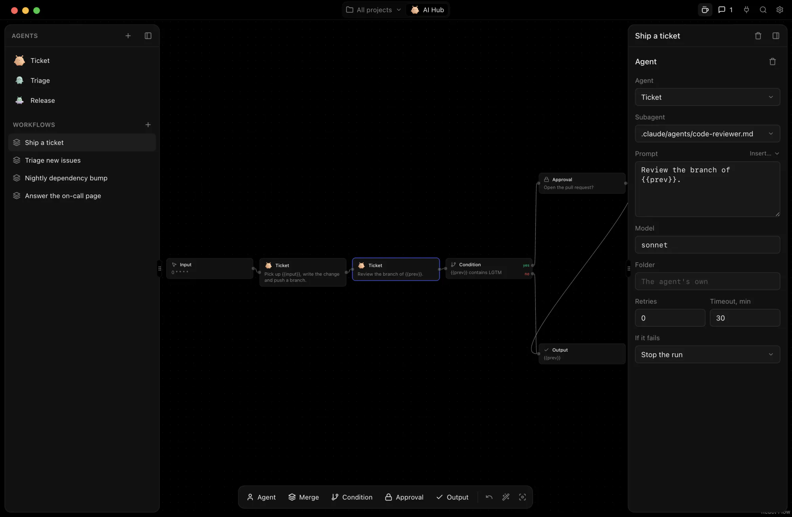
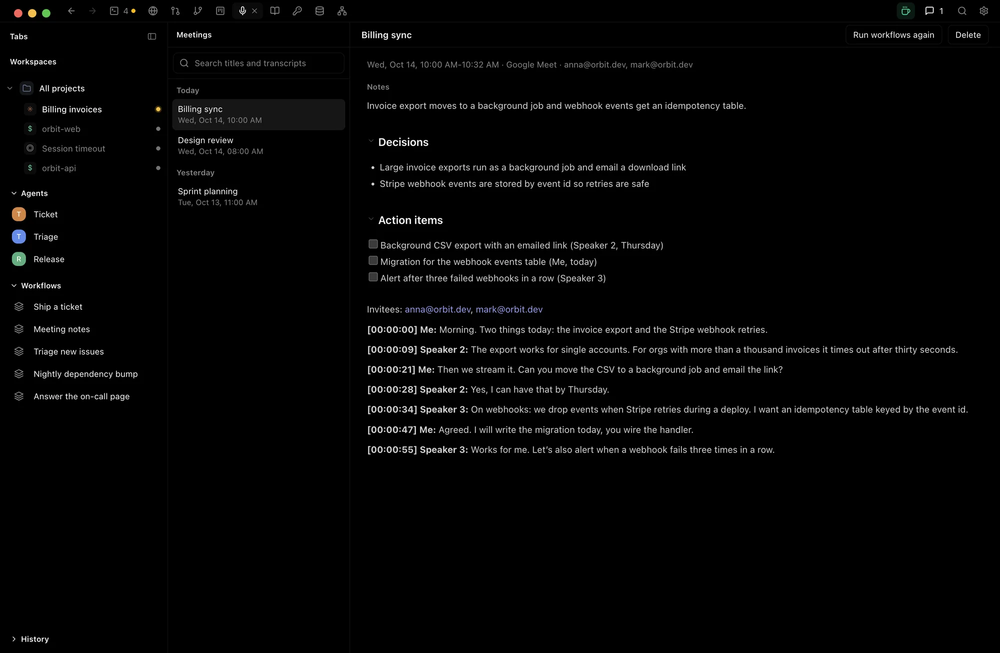
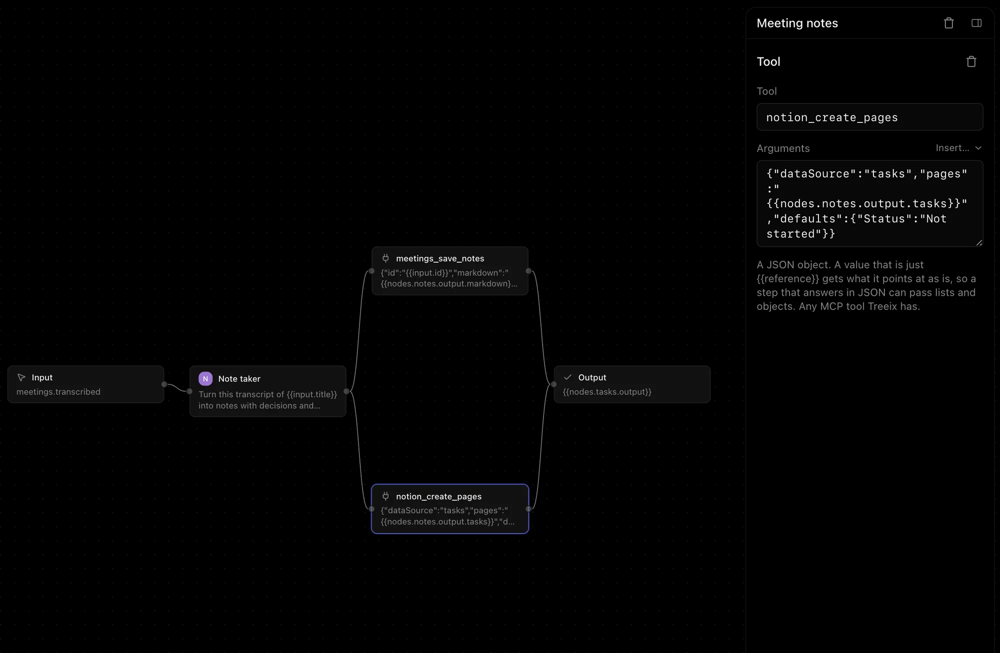
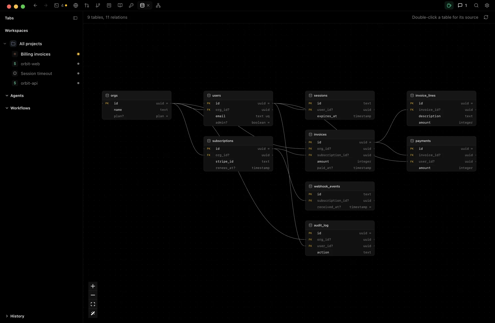
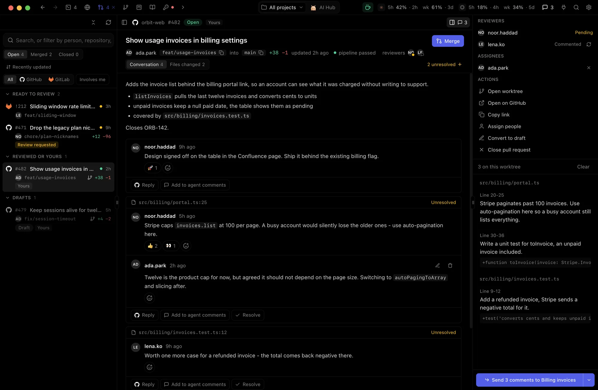
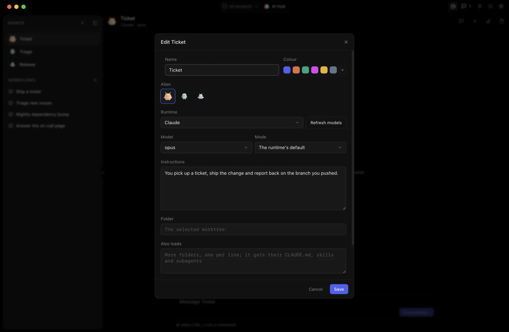
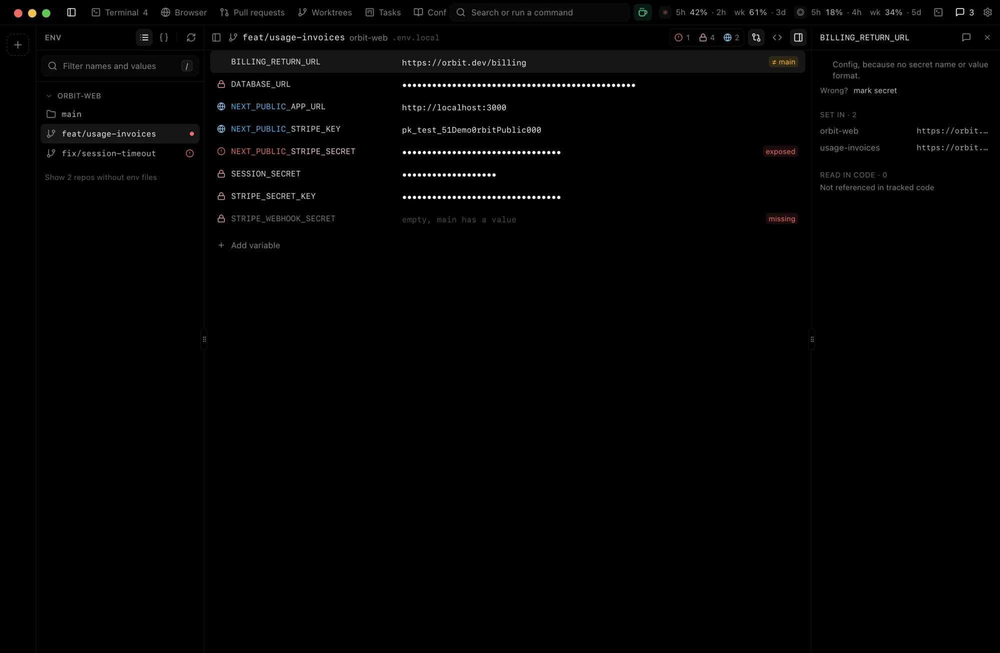

<div align="center">



# Treeix

**Your AI workspace. Everything you use daily, in one app.**

Your own agents, worktrees, diffs, pull requests, tickets and meetings in one Mac app.<br />Your review notes go back to the agent as its next prompt.

[](LICENSE)
[](#install)
[](https://github.com/zaxovaiko/treeix/releases/latest)
[](https://github.com/zaxovaiko/treeix/actions/workflows/ci.yml)
[](packages/README.md)

**[Download](https://treeix.dyvertex.com/download)** · [Website](https://treeix.dyvertex.com) · [80-second tour](https://youtu.be/Un4AvXgqtAM) · [Plugin docs](packages/README.md) · [Architecture](docs/architecture.md)

<a href="https://youtu.be/Un4AvXgqtAM"></a>

</div>

## Why

AI agents write code faster than anyone can read it. The reading is the bottleneck, and it is spread across a terminal, a git client, a browser tab per pull request and a tracker. Treeix puts a worktree, its diff, its review comments, its pull request and the agent session that produced it on one screen, and sends your comments straight back to the agent.

## Highlights

<table>
  <tr>
    <td width="50%" valign="top">
      
      <b>Review, then send it back.</b> Every worktree and its diff in one sidebar. Select lines, write a note, and the queue goes to the Claude Code or Codex session in that worktree.
    </td>
    <td width="50%" valign="top">
      
      <b>Your own agents, chained.</b> Agents on Claude Code, Codex, OpenRouter or Ollama, wired into workflows with conditions, approvals, schedules and tool steps.
    </td>
  </tr>
  <tr>
    <td width="50%" valign="top">
      
      <b>Meetings become notes.</b> Meet, Slack huddles, Zoom and Teams record on their own and are transcribed with speakers, on the Mac. A workflow writes the notes and tasks.
    </td>
    <td width="50%" valign="top">
      
      <b>See the architecture.</b> Packages, folder imports and Drizzle tables drawn as graphs, laid out to fit the screen with the fewest crossings.
    </td>
  </tr>
</table>

## Features

- **AI Hub.** Your own agents with a name, a face, a model and instructions. Chat, ask one question, or chain them into workflows started by hand, by a cron schedule or by another plugin's event.
- **Worktrees and review.** Every repository and checkout in one sidebar, split or unified diffs, line comments sent to an agent session.
- **Sessions that keep running.** Claude, Codex, a shell or any CLI agent survive a reload, docked next to the diff or in their own tab. Closed ones reopen from History.
- **Pull requests and tickets.** GitHub and GitLab through `gh` and `glab`, Jira and Confluence through `acli`, all beside the branch.
- **Meetings, Slack and Notion.** Calls turn into transcripts, Slack messages into batches, and workflows write the results to any Notion database.
- **Browser, editor, env.** Chromium with DevTools, a built-in editor with snapshots, and every `.env` file checked against `main`.

<details>
<summary><b>Everything else</b></summary>

- **Dependency graph and schema.** Packages, folder imports and Drizzle tables as diagrams, arranged to fit, left to right, top to bottom or as a grid.
- **Dictation.** Hold a key, speak, and the text lands in any app. Recognised on the Mac, optionally cleaned up by a local model.
- **Usage limits.** Claude and Codex 5-hour and weekly limits in the title bar.
- **Ports in the title bar.** The dev servers your worktrees run, with a button to stop one.
- **Workspaces.** Group the folders of one job together and switch with a digit; each keeps its own tabs and sessions.
- **Search everything.** One palette for commands, workspaces, files, pull requests, tickets and settings, plus `G` and a letter to jump from anywhere.
- **Agents can drive Treeix.** Its own MCP server lets a session start another session, save a workspace, run a workflow or, once allowed in Settings, use the browser.
- **Always a key away.** A global shortcut brings Treeix to the front, and it keeps the Mac awake while an agent works, with the lid closed if you ask.
- **Local models.** Download Ollama models from a rated list in Settings, with a fit check against your Mac's memory.
- **Themes.** Light and dark, after Vercel, Claude, Apple, Xcode, VS Code, GitHub, Nord, Dracula and Solarized.
- **Markdown.** Foldable headings, mermaid diagrams, private images and full screen zoom.
- **Everything is a plugin.** Switch a feature off in Settings and its code stops loading.

</details>

<details>
<summary><b>More screenshots</b></summary>
<br />

| | |
| --- | --- |
|  A transcript starts a workflow; tool steps save the notes and add Notion tasks |  Drizzle tables and foreign keys, read from the schema files |
|  A group per agent, with a badge when it waits for you |  A reviewer's comment becomes an agent task in one click |
|  Notes stack up, then go over as one prompt |  Comment on an element of the app your agent builds |
|  An agent is a name, a model and its instructions |  Env files across worktrees, checked against main |

</details>

## Install

Download the DMG from **[treeix.dyvertex.com/download](https://treeix.dyvertex.com/download)**. Apple silicon, macOS 14 or newer, signed and notarized by Apple.

Optional command line tools, each feature stays quiet without its own: `gh`, `glab`, `acli`, `claude`, `codex`, `ollama`.

## Plugins

The host in `apps/desktop` owns workspaces, worktrees, diffs, the editor, comments and settings. Everything else is a plugin in [`packages/plugins`](packages/plugins); writing one takes a `package.json` and a `renderer/index.tsx` ([guide](packages/README.md)).

<details>
<summary><b>All 19 plugins</b></summary>

| Plugin | Default | What it adds |
| --- | --- | --- |
| [`hub`](packages/plugins/hub) | on | Your own agents, workflows on a canvas started by hand, schedules or events, local model downloads, an MCP server |
| [`terminal`](packages/plugins/terminal) | on | Terminal tab and docked panel; Claude, Codex, shell and custom agent sessions that survive reloads |
| [`chat`](packages/plugins/chat) | on | Chat view for any agent with a chat command, next to its terminal |
| [`pull-requests`](packages/plugins/pull-requests) | on | GitHub and GitLab pull requests, review threads, viewed files, conflicts |
| [`browser`](packages/plugins/browser) | on | Chromium with DevTools, element comments, console and network capture |
| [`env`](packages/plugins/env) | on | Every `.env` across worktrees: secret, public or exposed, missing or different from main |
| [`dependencies`](packages/plugins/dependencies) | on | Package and folder import graphs of a worktree |
| [`schema`](packages/plugins/schema) | on | Drizzle tables, columns and foreign keys as a diagram |
| [`plans`](packages/plugins/plans) | on | Claude plans in the palette and on sessions |
| [`usage-limits`](packages/plugins/usage-limits) | on | Claude and Codex limits in the title bar |
| [`agent-usage`](packages/plugins/agent-usage) | on | Tokens and estimated cost per day, model and project, from Claude, Codex and Ollama session logs |
| [`themes`](packages/plugins/themes) | on | Light and dark themes after popular editors |
| [`diagrams`](packages/plugins/diagrams) | on | Mermaid code blocks, loaded on the first diagram |
| [`keep-awake`](packages/plugins/keep-awake) | on | Keeps the Mac awake while an agent works |
| [`meetings`](packages/plugins/meetings) | off | Records calls, transcribes them with speakers on the Mac, hands transcripts to workflows |
| [`slack`](packages/plugins/slack) | off | Collects Slack messages over Socket Mode for workflows, in batches |
| [`notion`](packages/plugins/notion) | off | `notion_create_pages` for agents and workflow steps, with a personal access token |
| [`dictation`](packages/plugins/dictation) | off | Hold a key, speak, paste into any app |
| [`jira`](packages/plugins/jira) | off | Jira work items, status changes, a worktree per item |
| [`confluence`](packages/plugins/confluence) | off | Confluence pages, search, page trees, link previews |

</details>

## Roadmap

- **Mobile app.** Keep an eye on your agents away from the Mac.
- **A proper UI.** A design pass so every screen feels like one product.
- **History archive.** Past sessions kept, searchable and one click from reopening.

Missing something? [Open an issue](https://github.com/zaxovaiko/treeix/issues/new) and say what you'd use it for.

## Contributing

Pick a roadmap item, write a plugin, or tell us where it breaks: your agents and repos are the best test suite Treeix has. Setup, checks and house style are in [CONTRIBUTING.md](CONTRIBUTING.md).

<details>
<summary><b>Development</b></summary>

```sh
bun install        # installs both apps and links packages/node_modules
bun run dev        # electron-vite dev
bun run typecheck  # tsc, both projects
bun run test       # bun test, app and packages
```

```
apps/desktop        the Electron app (main, preload, renderer)
apps/landing        static site for treeix.dyvertex.com
packages/sdk        the plugin contract
packages/plugins    the plugins
packages/atlassian  shared acli, Atlassian Document Format, credentials
```

More: [architecture](docs/architecture.md) · [releasing](docs/releasing.md) · [security](SECURITY.md)

</details>

## License

[Apache License 2.0](LICENSE). Use, modify and redistribute Treeix, commercially too, as long as you keep the license and the [NOTICE](NOTICE) file and state your changes. Forks and derivative works must credit Treeix:

> Built on Treeix (https://treeix.dyvertex.com), Copyright 2026 Treeix contributors, licensed under the Apache License 2.0.

The name and the icons are trademarks and are not part of the license grant.
