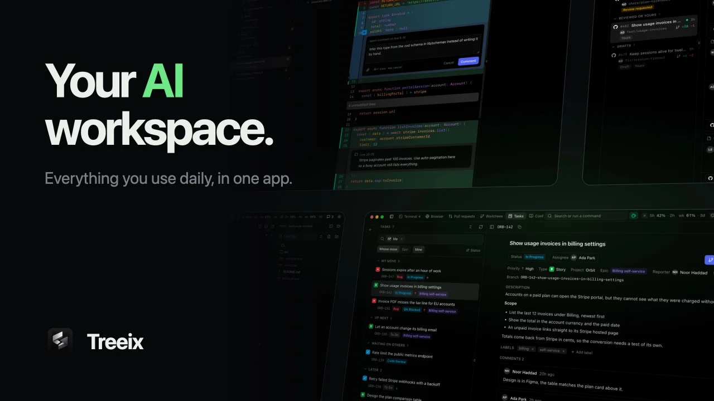
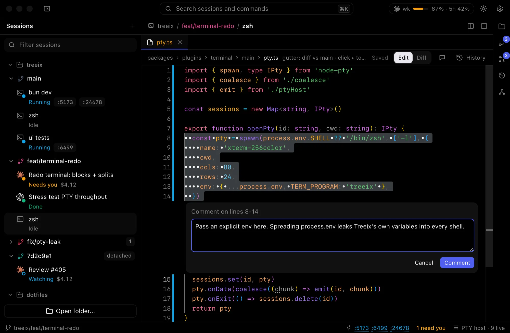
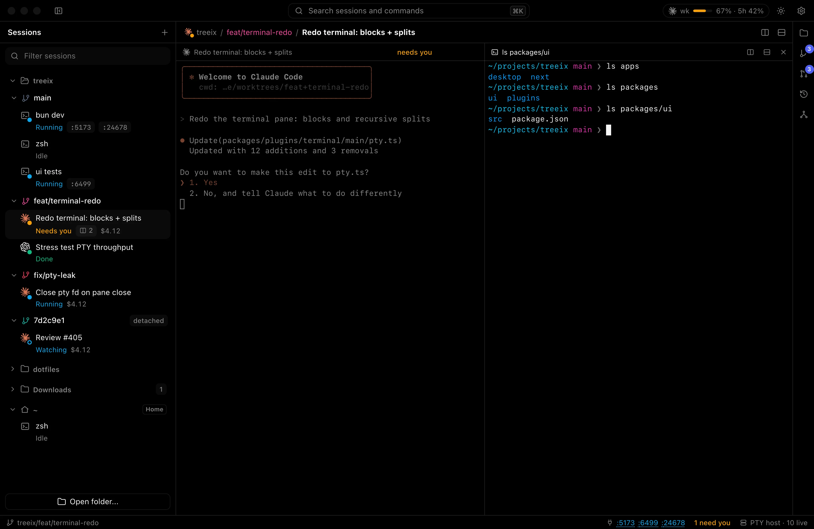
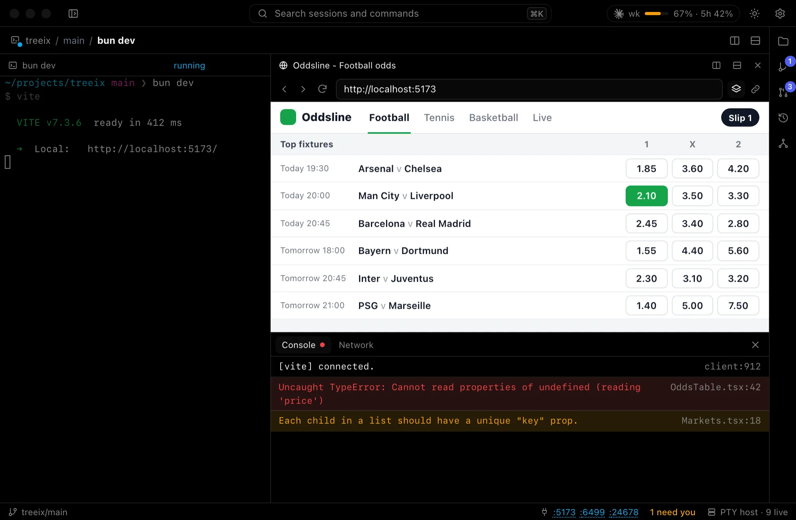
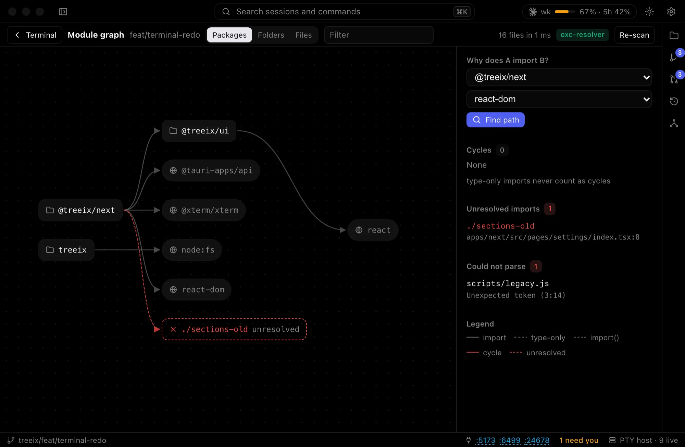
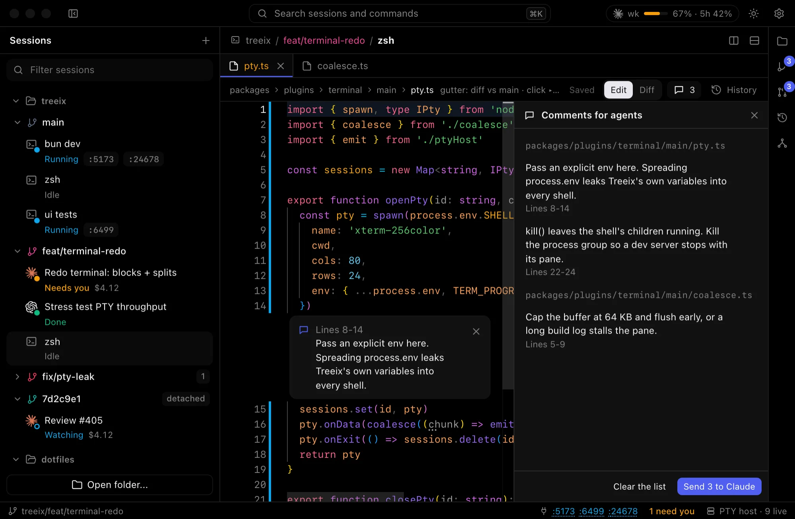

<div align="center">


# Treeix

**Your AI workspace. Everything you use daily, in one app.**

Agent sessions that keep running, worktrees, diffs, pull requests and tickets in one app for Mac and Linux.<br />Your review notes go back to the agent as its next prompt.

[](LICENSE)
[](#install)
[](https://github.com/zaxovaiko/treeix/releases/latest)
[](https://github.com/zaxovaiko/treeix/actions/workflows/ci.yml)

**[Download](https://treeix.dyvertex.com/download)** · [Website](https://treeix.dyvertex.com) · [80-second tour](https://youtu.be/Un4AvXgqtAM) · [Architecture](docs/architecture.md)

<a href="https://youtu.be/Un4AvXgqtAM"></a>

</div>

## Why

AI agents write code faster than anyone can read it. The reading is the bottleneck, and it's spread across a terminal, a git client, a browser tab per pull request and a tracker. Treeix puts a worktree, its diff, its review comments, its pull request and the agent session that produced it on one screen, and sends your comments straight back to the agent.

## Highlights

<table>
  <tr>
    <td width="50%" valign="top">
      
      Every worktree and its diff in one sidebar. Select lines, write a note, and the queue goes to the Claude Code or Codex session in that worktree.
    </td>
    <td width="50%" valign="top">
      
      A background daemon owns every shell and agent session. Quit Treeix, open it again, and they are still running, with their scrollback. A dot on Claude Code and Codex sessions says working, waiting for you or done.
    </td>
  </tr>
  <tr>
    <td width="50%" valign="top">
      
      A browser pane sits beside the terminal, on the system WebView, with a console and network view. Agents can open pages, read them, click and type through Treeix's MCP server.
    </td>
    <td width="50%" valign="top">
      
      A module graph shows who imports what in the repo, and marks import cycles and unresolved imports.
    </td>
  </tr>
</table>

## Features

- Every repository and worktree in one sidebar, an Explorer, and Changes with split or unified diffs. Line comments queue in a drawer and go to the Claude Code or Codex session in that worktree as its next prompt.
- Shells and agents live in the daemon, so quitting Treeix leaves them running. Sidebar or horizontal tabs, recursive splits, sessions grouped by repo and worktree, a quick terminal on a global shortcut, and notifications. Closed sessions reopen from History and the agent resumes its conversation.
- GitHub and GitLab pull requests go through `gh` and `glab`: list, check out, open, merge, and the CI checks. The Open worktree dialog starts from a branch, a pull request or a Jira or Notion ticket, and copies your `.env` files across.
- Routines are agent runs on a schedule, on a GitHub or Jira event (review requested, CI failed, a PR comment, a ticket assigned) or on a local webhook. They run in the repo, in a fresh worktree or in the pull request's worktree, with a turn budget and permissions. The daemon runs them, so they fire with Treeix closed. Each routine picks what a run leaves: local commits, a draft pull request, or a push to the pull request it worked on. Treeix commits, pushes and opens the pull request itself, so agents never get push or pull request tools, and the pull requests panel filters routine pull requests.
- Claude and Codex also run as a chat beside the terminal, kept across restarts. Race sends one prompt to several agents, a worktree each. The MCP server lets agents open files, panes and worktrees in Treeix.
- Settings, Phone serves a mobile page to your own Tailscale network, answered only for your Tailscale login. Answer agents that need you, type into terminals, reply in chats, run or switch routines and open the pull requests they made, with Treeix closed too.
- A Monaco editor with diffs, find in files and file history.

<details>
<summary><b>Everything else</b></summary>

- The browser pane runs on the system WebView instead of Chromium. Agents can open pages, read them, click, type and take screenshots; Settings has a switch for that.
- Claude Code's plans open as a pane, with mermaid diagrams and line comments.
- Hold a hotkey, speak, and dictation puts the text at the cursor. Apple silicon only, recognised on the Mac, off by default.
- Meeting recording turns a call into a transcript and a note, on the Mac. Apple silicon only, off by default.
- Claude and Codex 5-hour and weekly limits show in the title bar, and tokens per agent, model and project in its popover.
- The ports your sessions listen on are listed, with a button to open one in the browser pane and one to kill it.
- The command palette searches commands, worktrees, sessions, files, pull requests and settings in one go.
- Keep awake holds the Mac awake while agents work, with the lid closed if you ask.
- 14 dark and 8 light themes, including Vercel, Claude, Apple, Xcode, VS Code, GitHub, Solarized, Nord and Dracula.
- Usage, ports, chat, MCP, Jira, Notion, pull requests, keep awake, Race, routines, the browser, plans, the module graph, dictation, recording and the phone page each have a switch in Settings. A feature that is off does no work and disappears from the UI.

</details>

<details>
<summary><b>More screenshots</b></summary>
<br />



Notes stack up in the drawer, then go over as one prompt.

</details>

## Install

Download the DMG from [treeix.dyvertex.com/download](https://treeix.dyvertex.com/download). That one is for Apple silicon; Intel Macs take [treeix.dyvertex.com/download/intel](https://treeix.dyvertex.com/download/intel). macOS 13.3 or newer, signed and notarized by Apple. Dictation and meeting recording need Apple silicon.

On Linux, take the x86_64 AppImage from the [latest release](https://github.com/zaxovaiko/treeix/releases/latest).

Treeix updates itself through its built-in updater.

The command line tools are optional, and a feature stays quiet without its own: `gh`, `glab`, `acli` (Jira only), `claude`, `codex`, and `npx` for the chat view.

## Roadmap

- A native phone app for your agents, chats and routines.
- A Windows build.
- Sessions on your other machines over Tailscale and SSH, in the same sidebar.

Missing something? [Open an issue](https://github.com/zaxovaiko/treeix/issues/new) and say what you'd use it for.

## Contributing

Pick a roadmap item, or tell us where it breaks: your agents and repos are the best test suite Treeix has. Setup, checks and house style are in [CONTRIBUTING.md](CONTRIBUTING.md).

<details>
<summary><b>Development</b></summary>

```sh
bun install        # installs apps/desktop
bun run dev        # the UI in a browser, on a mock daemon
bun run app        # the Tauri app, with the real daemon
bun run typecheck  # tsc
bun run test       # bun test
cargo test --workspace
```

```
apps/desktop        the app: React UI in src, Tauri shell in src-tauri
apps/landing        static site for treeix.dyvertex.com
crates/proto        wire protocol between the app and ptyd
crates/ptyd         treeix-ptyd, the daemon that owns terminals and chats
crates/core         git, files, pull requests, agents, tickets and MCP, shared by both
```

More: [architecture](docs/architecture.md) · [releasing](docs/releasing.md) · [security](SECURITY.md)

</details>

## License

[Apache License 2.0](LICENSE). Use, modify and redistribute Treeix, commercially too, as long as you keep the license and the [NOTICE](NOTICE) file and state your changes. Forks and derivative works must credit Treeix:

> Built on Treeix (https://treeix.dyvertex.com), Copyright 2026 Treeix contributors, licensed under the Apache License 2.0.

The name and the icons are trademarks and are not part of the license grant.
